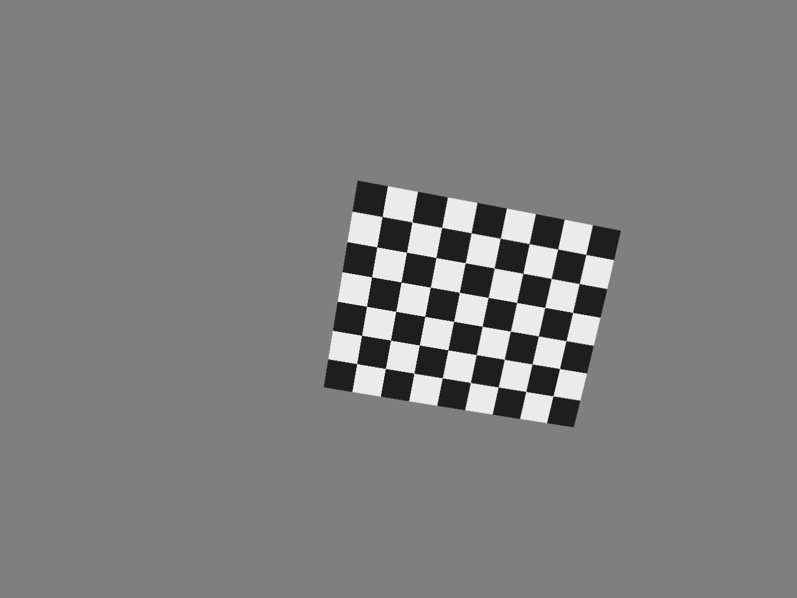
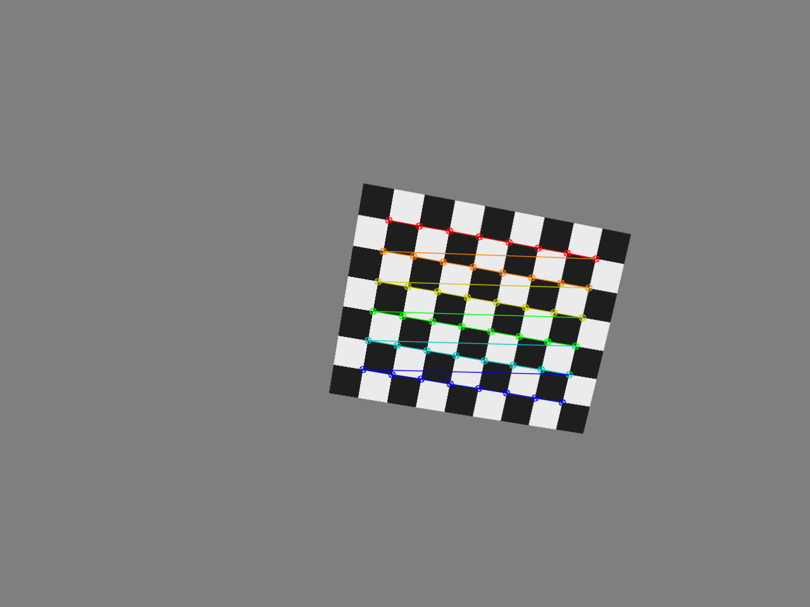
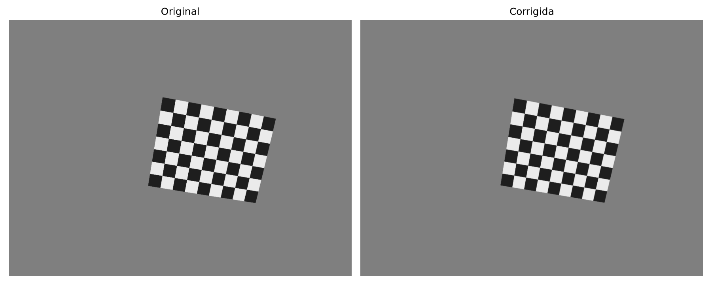
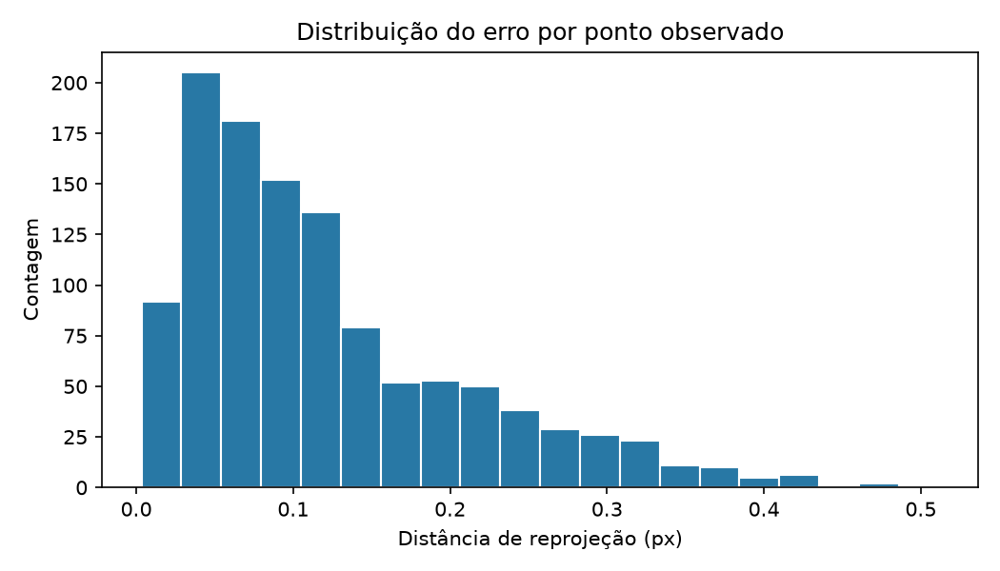

# Calibração monocular de câmera pelo método de Zhang

Projeto didático e reproduzível em Python/OpenCV para estimar intrínsecos, distorção e poses de uma câmera monocular a partir de diferentes vistas de um tabuleiro planar. Inclui um experimento sintético controlado, processamento de imagens reais, YAML compatível com o formato `plumb_bob` usado em ecossistemas de robótica e métricas próprias.

## Convenções e modelo

Usamos coordenadas do tabuleiro `(X,Y,Z)` com `Z=0`, tamanho de quadrado em metros por padrão, pontos de imagem `(u,v)` em pixels, origem no canto superior esquerdo, `u` para a direita e `v` para baixo. A pose transforma o tabuleiro para a câmera: `X_c = R X + t`. A projeção homogênea é

`s [u v 1]^T = K [R | t] [X Y Z 1]^T`, com `K = [[fx, γ, cx], [0, fy, cy], [0, 0, 1]]`.

`fx` e `fy` são distâncias focais expressas em pixels; `(cx,cy)` é o ponto principal; `γ` é o skew. O modelo padrão desta implementação mantém `γ=0`, como `cv2.calibrateCamera()` no uso padrão.

O vetor padrão é `D=(k1,k2,p1,p2,k3)`. Para coordenadas normalizadas `(x,y)`, `r²=x²+y²`, o fator radial é `1+k1r²+k2r⁴+k3r⁶`, e as coordenadas distorcidas são `xd=x·radial+2p1xy+p2(r²+2x²)` e `yd=y·radial+p1(r²+2y²)+2p2xy`. `k1,k2,k3` modelam distorção radial; `p1,p2`, tangencial. Não é um modelo fisheye.

## Zhang e OpenCV

Cada vista do plano induz uma homografia `H = K [r1 r2 t]`. Como as colunas de `R` são ortonormais, `h1ᵀ B h2=0` e `h1ᵀ B h1=h2ᵀ B h2`, onde `B=K⁻ᵀK⁻¹`. Várias orientações fornecem restrições para recuperar os intrínsecos; as colunas da homografia então dão a pose, seguida por refinamento não linear conjunto para reduzir o erro de reprojeção. A chamada `cv2.calibrateCamera()` implementa o procedimento de calibração e o refinamento conforme as opções e flags escolhidas; não deve ser entendida como apenas a etapa linear inicial.

O projeto calcula as métricas a partir dos pontos detectados e reprojetados. Para cada canto `e_ij=√((u_ij−û_ij)²+(v_ij−v̂_ij)²)`. Relatamos média de `e` por imagem e global, RMS por coordenada `√mean(dx²+dy²)`, máximo, mediana e percentil 95. O RMS escalar retornado pelo OpenCV é reportado separadamente e não substitui essas métricas.

## Estrutura

```text
monocular-camera-calibration-zhang/
├── generate_synthetic_board.py   # experimento sintético
├── calibrate_camera.py           # detecção, estimação e relatório
├── undistort_images.py           # aplicação da calibração
├── config/calibration_config.json
├── src/camera_calibration/       # geometria, métricas, YAML e figuras
├── tests/                        # testes unitários
├── data/{raw,processed,synthetic}/
├── results/{figures,reports}/
└── docs/{theory,methodology}.md
```

## Instalação

Requer Python 3.10 ou superior. No Windows PowerShell:

```powershell
python -m venv .venv
.\.venv\Scripts\Activate.ps1
python -m pip install --upgrade pip
pip install -r requirements.txt
python --version
python -c "import cv2; print(cv2.__version__)"
```

Linux/macOS: `python3 -m venv .venv`, `source .venv/bin/activate`, depois instale `requirements.txt`.

## Experimento sintético controlado

Da raiz do repositório:

```powershell
python generate_synthetic_board.py --images 18 --width 1280 --height 960 --corners 8 6 --square-size 0.025 --seed 42
python calibrate_camera.py --images data/synthetic/images --output results/synthetic --corners 8 6 --square-size 0.025 --minimum-views 5
```

As imagens seguem um padrão de tabuleiro renderizado por homografia e remapeamento conforme a distorção radial/tangencial declarada. `synthetic_ground_truth.json` e `manifest.json` ficam junto às imagens sintéticas; os parâmetros verdadeiros servem apenas para avaliação e não são entrada do calibrador. A interpolação e a rasterização podem afetar a localização dos cantos. O número de quadrados em cada direção é uma unidade maior do que a quantidade de cantos internos; por exemplo, 8×6 cantos requer 9×7 quadrados.

O gerador verifica que os cantos projetados fiquem em uma região segura da imagem e usa semente configurável. A composição plana é projetada por homografia e depois cada pixel é remapeado para modelar distorção; bordas externas são recortadas pelo quadro da imagem. Resultados de simulação não devem ser apresentados como calibração de câmera real.

### Amostras reproduzidas

As figuras abaixo foram geradas neste repositório pelo conjunto de 24 imagens. Os intrínsecos verdadeiros foram `fx=1126,40`, `fy=1152,00`, `cx=640,00`, `cy=480,00`; a estimativa foi `fx=1126,85`, `fy=1152,63`, `cx=638,77`, `cy=480,31`. A média por ponto foi `0,1211 px` e RMS por coordenada `0,1510 px`. Os coeficientes radiais de ordem mais alta apresentaram correlação e não recuperaram individualmente o ground truth com a mesma precisão; interprete esse experimento como validação geométrica controlada, não como promessa de estimativa exata de cada coeficiente.









## Imagens reais e correção

Fotografe um tabuleiro rígido e plano, mantendo foco e zoom constantes. Cubra várias regiões do quadro e varie inclinação e rotação; evite vistas apenas frontais. Passe imagens em uma pasta e use as mesmas dimensões:

```powershell
python calibrate_camera.py --images data/raw --output results/real --corners 8 6 --square-size 0.025 --unit m
python undistort_images.py --images data/raw --calibration results/real/camera_calibration.yaml --output data/processed --alpha 0
```

`alpha=0` recorta regiões sem pixels válidos; `alpha=1` preserva mais campo de visão com bordas vazias. Para tabuleiro diferente, ajuste o número de cantos e o tamanho real do quadrado.

## Saídas

- `camera_calibration.yaml`: `camera_matrix`, `distortion_coefficients`, largura/altura, modelo `plumb_bob` e unidade.
- `calibration_report.json`: parâmetros, poses por arquivo, imagens rejeitadas e métricas.
- `figures/detected_corners.png` e `figures/reprojection_errors.png`.
- O comando de correção salva imagens corrigidas e `comparison.png`.

Exemplo da estrutura YAML (valores ilustrativos, não resultados medidos):

```yaml
%YAML:1.0
camera_matrix: !!opencv-matrix
   rows: 3
   cols: 3
   dt: d
   data: [ 900., 0., 640., 0., 900., 480., 0., 0., 1. ]
distortion_coefficients: !!opencv-matrix
   rows: 1
   cols: 5
   dt: d
   data: [ -0.1, 0.02, 0.001, -0.001, 0. ]
image_width: 1280
image_height: 960
distortion_model: plumb_bob
```

Os artefatos gerados são ignorados pelo Git por padrão, pois podem ser recriados. Para incluí-los deliberadamente em um experimento, remova a regra relevante do `.gitignore`.

## Testes

```powershell
python -m pytest -q
```

Os testes cobrem geometria, projeção, métricas, correção com distorção nula e leitura/escrita YAML. A validação completa de recuperação sintética deve ser feita pelos comandos de geração e calibração e comparando `calibration_report.json` com o ground truth; não se deve exigir recuperação pixel-perfect devido à rasterização e à detecção subpixel.

## Limitações e uso em VO

A precisão depende da planicidade e dimensão física do padrão, nitidez, cobertura do campo de visão, diversidade de poses, resolução e modelo de lente. Parâmetros de distorção podem se correlacionar e exigir observações variadas. O projeto calibra uma câmera central pinhole; lentes fisheye requerem outro modelo e outras funções.

Intrínsecos e distorção permitem corrigir imagens e normalizar coordenadas antes de extrair/corresponder características. Em uma pipeline de Odometria Visual monocular, essas observações apoiam a estimação da matriz essencial, a recuperação de movimento relativo e a triangulação. A calibração fornece informação geométrica, mas não estima por si só movimento ou escala métrica da trajetória.

## Referências

- Zhengyou Zhang, “A Flexible New Technique for Camera Calibration”, IEEE Transactions on Pattern Analysis and Machine Intelligence, 22(11), 1330–1334, 2000. DOI: [10.1109/34.888718](https://doi.org/10.1109/34.888718).
- OpenCV, [Camera Calibration and 3D Reconstruction](https://docs.opencv.org/4.x/d9/d0c/group__calib3d.html).
- OpenCV, [findChessboardCorners](https://docs.opencv.org/4.x/d9/d0c/group__calib3d.html).
